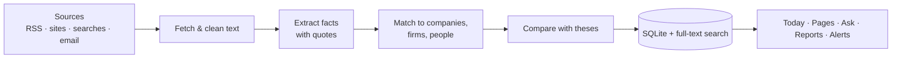

<div align="center">


# Thesis Desk

**Track your investment theses against the news — with every claim linked to its source.**

[](https://github.com/JSai23/thesis-desk/actions/workflows/ci.yml)
[](LICENSE)


[Features](#features) · [Install](#installation) · [Usage](#usage) · [Development](#development) · [Contributing](#contributing)


</div>

## The problem

If you invest in startups, you hold a handful of **theses**, such as "vertical AI will beat horizontal tools in
regulated industries". The evidence for and against them is spread across newsletters, blogs, funding announcements
and news sites. Keeping up means reading all of it, remembering who raised from whom, and noticing when something
contradicts what you believe.

Generic AI summaries don't solve this. They can't tell which facts matter to *your* theses, and you can't trust a
summary that you can't check.

## What Thesis Desk does

Thesis Desk is a macOS app that reads your sources for you and keeps a structured, sourced picture of your market:

1. **You choose the sources:** RSS feeds, blogs, news searches, newsletters, and links you paste in.
2. **It reads every new article** and pulls out facts (funding rounds, hires, launches), each with the exact quote it
   came from.
3. **It builds pages** for the companies, investors and people mentioned, and keeps them up to date.
4. **It checks each fact against your theses** and records whether the fact supports or contradicts them, and why.
5. **It shows you what changed** in a daily feed, in reports you describe in plain English, and in alerts.

Every AI-written sentence is checked against the text it cites. If a sentence can't be backed by a source, it is
removed instead of shown.

## Features

- 📰 **Today feed.** New stories sorted into *Following*, *Your theses* and *Headlines*, each with why it matters.
- 🎯 **Theses.** Evidence for and against each thesis, how your conviction has changed, and suggested sources.
- 🏢 **Company and investor pages.** Funding history, investors, people and recent activity, built from what you read.
- 🔍 **Search and ask (⌘K).** Find anything, or ask a question and get an answer that cites a source on every line.
- 📊 **Reports and briefings.** Describe a report ("seed deals in vertical AI, weekly") and get a sourced write-up;
  bundle reports into a scheduled email.
- 🔔 **Alerts.** For example, "tell me when a firm I follow leads a round", in the app or by email.
- ✏️ **Corrections in plain English.** "Merge AWS into Amazon Web Services". Every edit can be undone.
- 🔒 **Local-first.** Your library is a SQLite database on your Mac. There is no Thesis Desk server or account.

### Demo

<table>
<tr>
<td width="50%"><b>Today</b><br/></td>
<td width="50%"><b>Theses</b><br/></td>
</tr>
<tr>
<td><b>Companies and firms</b><br/></td>
<td><b>Search and ask</b><br/></td>
</tr>
<tr>
<td colspan="2" align="center"><b>Sources and reports</b><br/></td>
</tr>
</table>

## Installation

There is no prebuilt download yet. Build the app from source:

**Requirements**

- macOS 14 or later, with the Xcode Command Line Tools (`xcode-select --install`)
- Node.js 24 and npm 11+
- For AI features: the [Codex CLI](https://github.com/openai/codex), signed in with a ChatGPT account
  (`codex login`). Thesis Desk uses that sign-in, so you don't need an API key. Without it, the app still collects
  and stores your sources.

```bash
git clone https://github.com/JSai23/thesis-desk.git
cd thesis-desk
npm ci
npm run dist
```

This builds `app/dist/Research Workspace.app` and a `.dmg`. (Inside the app, it is called **Research Workspace**.)
The build is not notarized, so the first time you open it, right-click the app and choose **Open**.

## Usage

1. **Add sources.** Go to *Sources* and paste an RSS feed, a blog URL, or a news search such as "vertical AI funding".
2. **Write a thesis.** Go to *Theses* and describe what you believe, in your own words. The app matches it against
   everything it has already read.
3. **Follow companies and firms.** Thesis Desk looks them up and starts watching them for news.
4. **Read Today.** Open a story to see why it matters and which theses it affects.
5. **Ask.** Press ⌘K and ask a question, such as "Who led rounds in legal AI this quarter?"

**Optional: email.** To get briefings by email or read newsletters from your inbox, open *Settings ▸ Accounts ▸
Gmail* and enter your address and a Gmail [app password](https://support.google.com/accounts/answer/185833).

### Privacy

| Data | Where it goes |
|---|---|
| Your library (sources, articles, notes, theses, reports) | Stays on your Mac, in `~/Library/Application Support/Research Workspace/` |
| Article text, notes, theses and questions | Sent to OpenAI through your own ChatGPT sign-in, for AI processing |
| Report emails | Sent through your Gmail account, if you set it up |
| Passwords and site sign-ins | Encrypted with the macOS Keychain, never logged |

## Development

```bash
npm ci          # install dependencies and rebuild native modules for Electron
npm run dev     # run the app with hot reload
```

### Architecture



- **Main process** (`app/src/main`): the database (better-sqlite3), a job queue and scheduler, source fetchers,
  email, and the AI tasks. Each AI task has a typed schema and a validator, in `app/src/main/ai/tasks`.
- **Renderer** (`app/src/renderer`): the React UI. It talks to the main process only through a typed IPC API,
  `app/src/shared/ipc.ts`.
- **Grounding** (`app/src/main/ai/grounding.ts`): checks that names, numbers and dates in generated text appear in
  the cited source.

### Project structure

```
app/src/main        Electron main process: db, jobs, sources, ingest, ai, entities, theses, reports, mail
app/src/renderer    React UI
app/src/shared      IPC contract and types shared by both processes
tests/              Playwright tests: smoke, end-to-end, real-data, live
fixtures/           local fixture server with test sites, feeds and email
docs/               specification, design decisions, test plan
```

### Testing

Tests run the real app through Playwright, headless (no window opens).

| Command | What it does |
|---|---|
| `npm run test:quick` | Tests for the files you changed. Uses recorded AI answers, so it is fast. |
| `npm run test:area` | All tests in the areas you changed, including tests against real websites. |
| `npm run typecheck` | TypeScript type check. |
| `npm run audit:static` | Static checks, such as every test is tagged and no test opens a window. |
| `npm run accept` | The full suite. Slow; needs network access and a Codex sign-in. |

See [docs/TestPlan.md](docs/TestPlan.md) for details.

### Documentation

- [docs/RFC.md](docs/RFC.md): the full product and technical specification
- [docs/Decisions.md](docs/Decisions.md): design decisions and their reasons
- [docs/TestPlan.md](docs/TestPlan.md): how the test suites are organized
- [docs/Backlog.md](docs/Backlog.md): planned work

## Contributing

Contributions are welcome. Read [CONTRIBUTING.md](CONTRIBUTING.md) for the development workflow and code
conventions, and [SECURITY.md](SECURITY.md) to report a vulnerability.

## License

[MIT](LICENSE) © 2026 JayaSai Somasundaram
