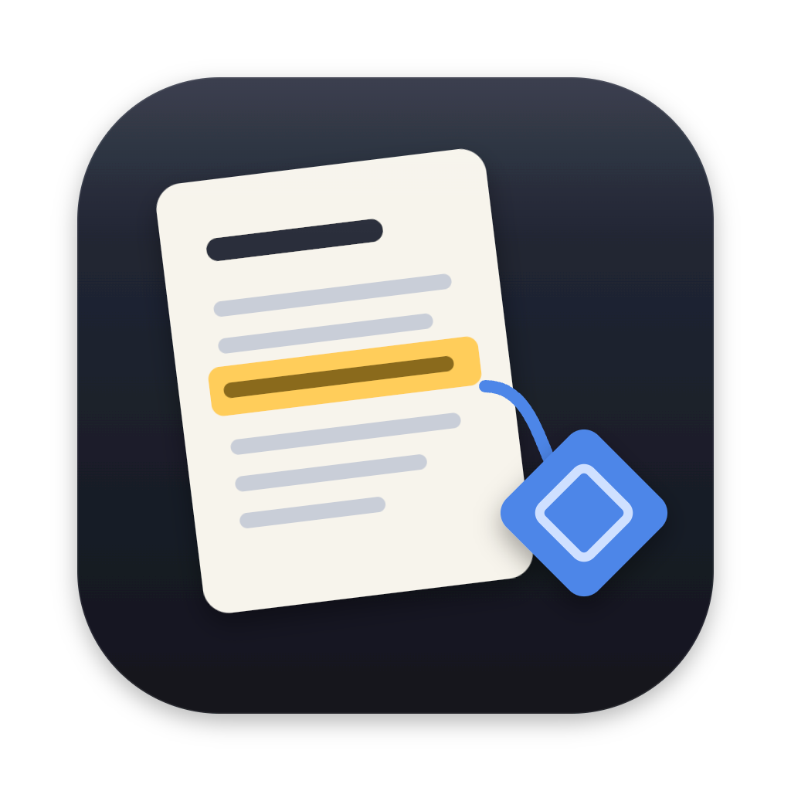
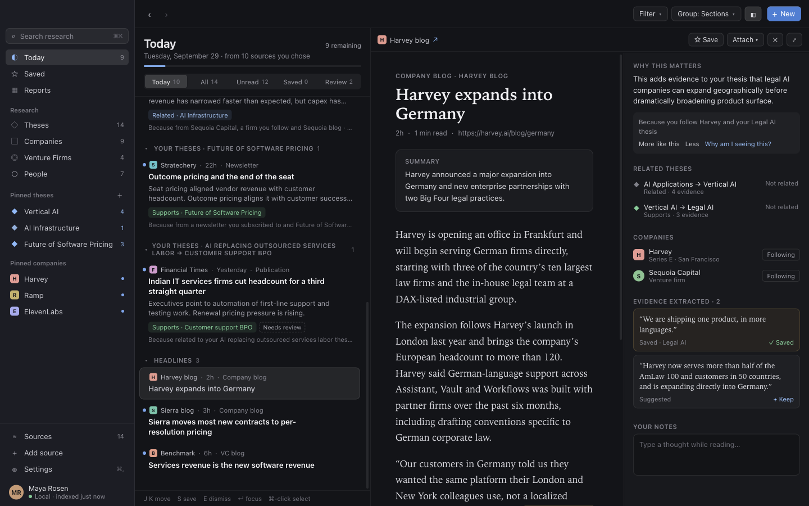
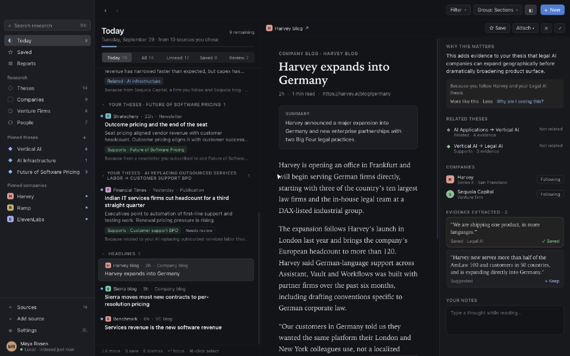
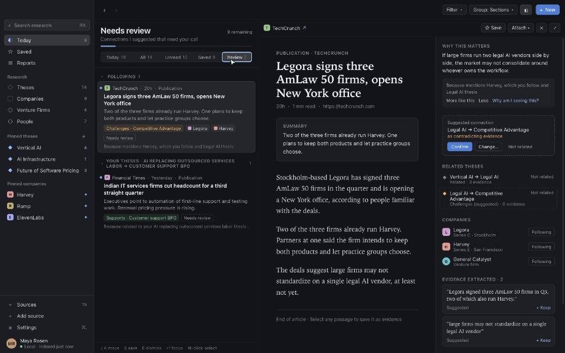
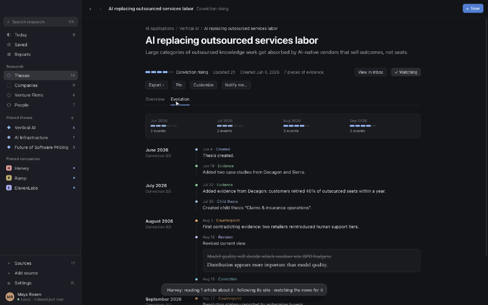
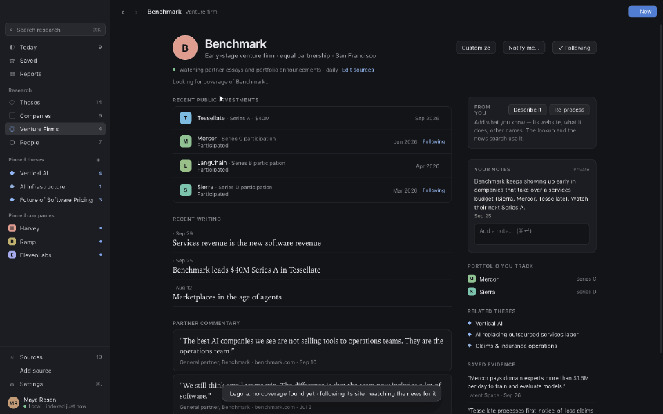
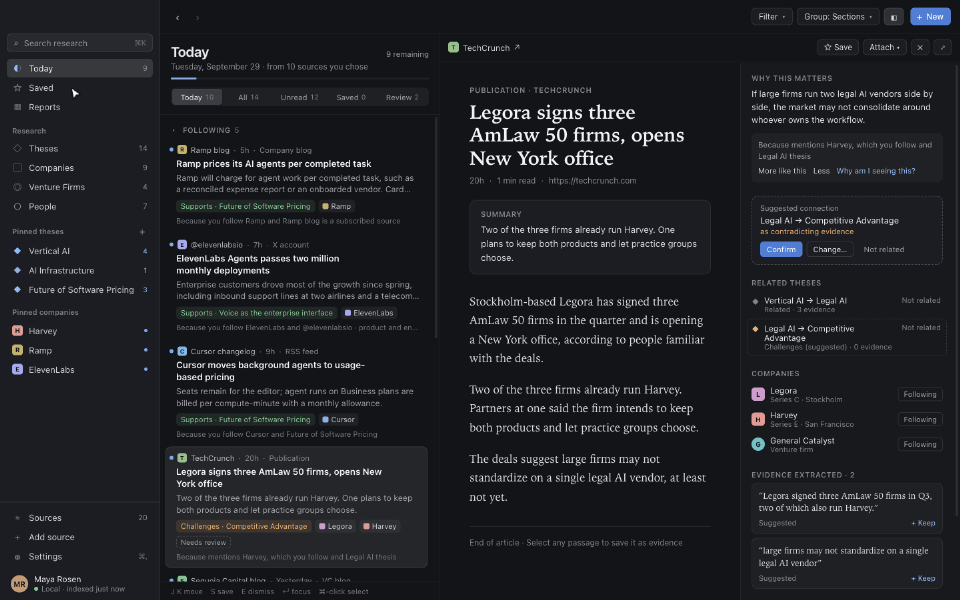
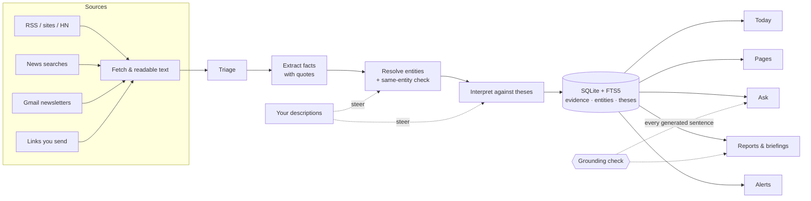

<div align="center">



# Thesis Desk

**A local-first research desk for venture investors.**<br/>
It reads the sources you choose, turns them into cited evidence about companies, firms, people and your investment
theses, and tells you what changed — every sentence traceable to the text it came from.

[](https://github.com/JSai23/thesis-desk/actions/workflows/ci.yml)
[](LICENSE)


<br/>
[](docs/VerificationReport.md)




</div>

> The desktop app's name is **Research Workspace**; the repository is Thesis Desk because that is what it is for:
> keeping a running, sourced case for and against each thesis you hold.

## Why

An investor's thesis lives in their head, and the evidence for it is scattered across newsletters, blogs, funding
announcements and the odd tweet. Thesis Desk watches those sources for you, reads every new article, and keeps three
things up to date: **who** (companies, firms, people — with funding, investors and partners), **what happened** (facts,
each quoted from its source), and **what it means for your theses** (supporting or contradicting, with a reason).

It is built around three rules:

- **Grounded or dropped.** Every fact carries the quote it came from; every generated sentence — summaries, report
  ledes, deep dives, answers — is checked against the text it cites (names, numbers, dates, roles). Anything that
  doesn't hold is removed, not shown.
- **Your words come first.** What you say about a company or thesis is kept apart from what the agent finds, never
  overwritten, and steers the agent's work. A summary sentence that rests on your words is marked *(your words)*.
- **Local first.** Your library is a SQLite database on your Mac. There is no Thesis Desk server.

## Demo

<table>
<tr>
<td width="50%"><b>Today</b> — what's new in your sources, sorted into Following, Your theses and Headlines; open a story to see why it matters and the evidence it carries.<br/></td>
<td width="50%"><b>Theses</b> — each thesis with the evidence for and against it, how your conviction changed, and suggested sources.<br/></td>
</tr>
<tr>
<td><b>Companies &amp; firms</b> — funding history, investors, people and activity, built from what you read; firms with their portfolio and partners' writing.<br/></td>
<td><b>Search &amp; ask (⌘K)</b> — find anything, or ask a question and get an answer where every line cites its source.<br/></td>
</tr>
<tr>
<td colspan="2"><b>Sources &amp; reports</b> — the sources you watch (RSS, sites, newsletters, searches) and reports you describe in plain English, read in the app; briefings bundle them into an email.<br/></td>
</tr>
</table>

<sub>Clips recorded headlessly from the built app on its bundled demo library — `npm run demo:record`.</sub>

## Features

| | |
|---|---|
| **Sources** | RSS/Atom, any web page or blog, Hacker News, saved news searches, Gmail newsletters, sites you sign in to, and links you send. Each source has a mode ("everything" / "only what's relevant to …"), a schedule and a trust level. |
| **Reading pipeline** | Fetch → readable text → triage → fact extraction with quotes → entity resolution (with a same-entity check against your description) → thesis interpretation (support / contradict, with the words of the thesis it bears on) → Today. |
| **Following** | Follow a company, firm, person or thesis and it is looked up at once: your library, a web search, its own site, and a standing news watch — even when nothing is found yet. Connected entities (a followed firm's portfolio) get lighter forward-only watches. |
| **Theses** | Hierarchical theses with a description, conviction, current view, thoughts and open questions. A new or reworded thesis is matched against every fact already stored. |
| **Your layer** | "Describe it" when adding anything; a *From you* card on every page; **Re-process** any object (re-run its lookup, re-read its articles, re-match a thesis) with a summary of what changed and Undo. |
| **Ask** | ⌘K questions answered from your library, each line cited; says so when the library has no evidence. |
| **Reports & briefings** | Describe a report in plain English ("Seed and Series A deals in vertical AI, weekly"); it compiles into sections, renders as an illustrated, grounded story with deep dives, and can be refined in place. Briefings bundle reports into a scheduled email. |
| **Alerts** | "Tell me when a firm I follow leads a round" — structured filters plus an optional judged condition, in-app and by email. |
| **Corrections** | Fix anything in plain English ("merge AWS into Amazon Web Services", "Mercury is a different company from Mercury Insurance"); every edit is an undoable operation with history. |
| **Pages you shape** | Customize any page by instruction ("put funding history first, track employee count") — the layout is a validated JSON patch, custom fields are extracted with provenance. |

## How it works



- **Electron main process** owns the database (better-sqlite3, WAL, FTS5), a durable job queue with leases and
  retries, a scheduler, the source fetchers (HTTP with robots.txt and politeness; an offscreen renderer for script-only
  pages; per-site sign-in partitions), mail (IMAP/SMTP), and 23 AI tasks, each a typed contract with a schema and a
  validator (`app/src/main/ai/tasks`).
- **Renderer** is a React UI ported from an approved design prototype; it talks to main only through a typed IPC
  boundary (`app/src/shared/ipc.ts`, zod-validated).
- **AI** runs through your own ChatGPT sign-in (the Codex CLI's credentials) — no API key. Answers that fail their
  schema or grounding are retried, then dropped.

The full specification is [docs/RFC.md](docs/RFC.md); every deviation from it is recorded in
[docs/Decisions.md](docs/Decisions.md) (101 decisions).

## Getting started

**Requirements:** macOS 14+, Xcode Command Line Tools, Node 24 and npm 11. AI features need the
[Codex CLI](https://github.com/openai/codex) signed in with ChatGPT (`codex login`); without it the app still collects
and stores your sources.

```bash
git clone https://github.com/JSai23/thesis-desk.git
cd thesis-desk
npm ci                 # also rebuilds better-sqlite3 for Electron
npm run dev            # run with hot reload
```

Build the app and installer:

```bash
npm run dist           # → app/dist/Research Workspace.app and a .dmg
```

The build is ad-hoc signed, not notarized: the first time, right-click the app → **Open**. Email delivery and
newsletters are optional: Settings ▸ Accounts ▸ Gmail (address + an app password).

## Testing

Tests drive the real app through its public IPC and UI with Playwright — **headless**: no window, no Dock icon (a
static audit fails any test that could open one).

| Command | What it runs |
|---|---|
| `npm run test:quick` | the tests for the files you changed (area tags + changed-files map), fixture AI answers replayed — minutes |
| `npm run test:area` | every test in the changed areas, plus the real-data tests for them |
| `npm run accept` | the full acceptance: clean rebuild, everything live — smoke, backend E2E, product E2E, real-data stage, live sources, blind evaluations by fresh agents, coverage of all 127 requirements |
| `npm run realdata` | the real-data stage alone: real sites, RSS, news searches and email, judged against the live web |
| `npm run audit:static` · `npm run typecheck` | the static audit and the type check (also run in CI) |
| `npm run demo:record` | re-record the README clips |

How the suites are laid out and when each runs is in [docs/TestPlan.md](docs/TestPlan.md); the latest full run is in
[docs/VerificationReport.md](docs/VerificationReport.md). The fixture server (`fixtures/server`) serves a deterministic
corpus of sites, feeds, a sign-in site and email on `127.0.0.1:4700`. Gmail-dependent tests read credentials from
`prereq/.env.local` (test harness only — the app never reads it).

## Project layout

```
app/src/main        Electron main: db, jobs, scheduler, sources, ingest, ai, entities, theses, reports, mail, ipc
app/src/renderer    React UI (view models in vm/, views in view/)
app/src/shared      IPC contract, DTOs and schemas shared by both sides
tests/              harness, smoke, e2e-backend, e2e-product, realdata, live, blind, demo
fixtures/           deterministic fixture server and corpus
design/             the approved design prototype the UI was built from
prereq/             environment and dependency probes
docs/               RFC, decisions, test plan, verification report, backlog, engineering notes
```

## Privacy

- **On your Mac:** your library — sources, articles, evidence, notes, theses, reports — in
  `~/Library/Application Support/Research Workspace/`.
- **Sent elsewhere:** article text, notes, theses and questions go to OpenAI through your own ChatGPT sign-in; report
  emails go through your Gmail; the app makes ordinary web requests to the sites you watch.
- Secrets (Gmail app password, site sign-ins) are encrypted with the macOS Keychain and never logged.

## Documentation

| | |
|---|---|
| [RFC](docs/RFC.md) | the build specification: product, architecture, data model, every requirement and its tests |
| [Decisions](docs/Decisions.md) | every decision and deviation, with context and alternatives |
| [Test plan](docs/TestPlan.md) | suites, area tags, replay vs live, how long each takes |
| [Verification report](docs/VerificationReport.md) | the latest full acceptance run |
| [Backlog](docs/Backlog.md) | what's next and what shipped |
| [Engineering notes](docs/Memory.md) | lessons from building and testing it (flaky waits, grounding, races) |

## Contributing

Issues and pull requests are welcome — see [CONTRIBUTING.md](CONTRIBUTING.md).

## License

[MIT](LICENSE) © 2026 JayaSai Somasundaram
